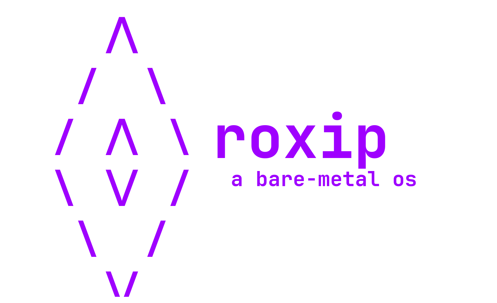

###### _
</a>simple, not required to exceed 15,000 lines of code
_

  

# roxiP

A portable ARM-based operating system (based solely on .bin files)

> [!NOTE]
> This its a early stage, Expect errors or imperfections

## About
This is a bare-metal operating system project, designed primarily for portability.

It relies on a `.bin` file; therefore, you need a bootloader to load this file and locate the storage file.

Yes, a storage file—instead of traditional partitions, the system uses a single file to store data and other information.

This approach ensures portability, allowing you to allocate a specific amount of storage (in MB or GB).

The system is built on a YAFS (Yet Another File System)—a lightweight, custom-designed file system tailored specifically for this storage file. The goal is for it to run on various hardware, including Chinese-manufactured devices, Raspberry Pi, and other ARM-based platforms.
   
## Contrib
<table>
  <tbody>
    <tr>
      <td align="center" valign="top" width="14.28%"> <b>pascalX</b></a> <a href="https://codeberg.org/pascalX" title="Code">😒</a></td>
      <td align="center" valign="top" width="14.28%"> <b>Andrew (AndresDev859674)</b></a> <a href="https://github.com/AndresDev859674" title="Code">💻</a></td>
    </tr>
  </tbody>
</table>
